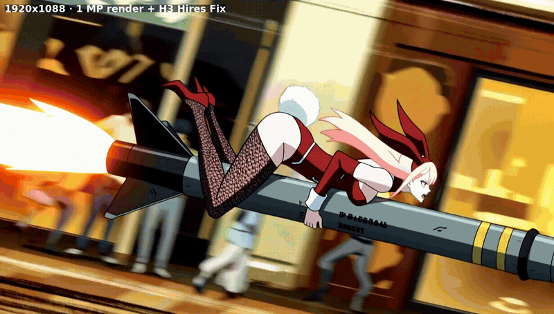
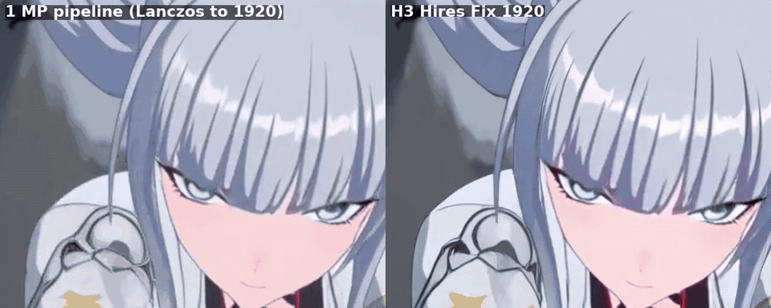
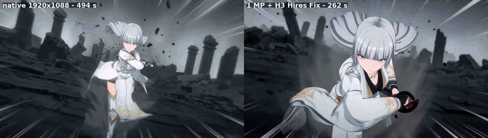
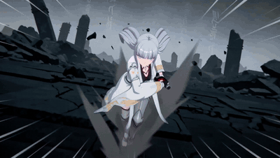
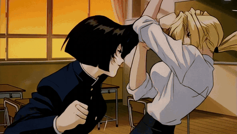
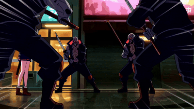
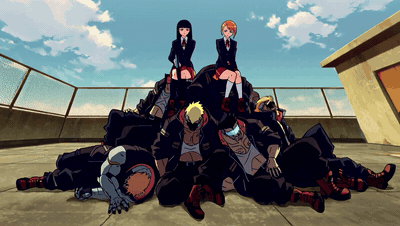
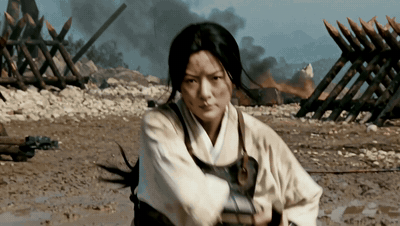

# ComfyUI-H3-ResCascade

**Render MiniMax H3 at 1 MP, finish at 1080p or 1440p: about half the time of a native render, with the same take and
the same audio.** A tested hires recipe packed into one node, built on
[LBH-123-AI's latent upscaler](https://huggingface.co/LBH-123-AI/Minimax_h3_latent_Upscaler).

*Edgerunners LoRA, 1920x1088, after Fast De-rope + FaceDetail + Anime Cadence at 1 MP.*
([mp4 with sound](assets/demo_rocket_1920.mp4))

## The speed-up, measured

Going from 1 MP to 2 MP (1920x1088) costs **about a minute instead of about five**:

| clip (5 s, RTX 5090) | 1 MP render | **1 MP + H3 Hires Fix -> 1920x1088** | native 1920x1088 | overall |
|---|---|---|---|---|
| Teen Titans punch | ~178 s | **237 s** (+59 s) | 492 s (+314 s) | **2.1x faster** |
| base H3 sword fight | 194 s | **~262 s** (+69 s) | 494 s (+300 s) | **1.9x faster** |
| Edgerunners rocket | 185 s | **~253 s** (+68 s) | 511 s (+326 s) | **2.0x faster** |

## What you get

- **About 2x faster than a native 2 MP render** (table above), and 1440p (~3.7 MP) in ~337 s on a 32 GB card.
- **You keep the take you liked.** A native 2 MP render is a different take from the 1 MP one (changing the resolution
  changes the whole render). Here the 1 MP render *is* the take: preview at 1 MP in ~3 min, then upscale only the
  keepers.
- **Your audio is untouched.** The pass-1 soundtrack is pinned; the hires output carries it sample for sample.
- **Real detail, not a blur.** The hires step redraws lines and texture at the new size: +29% fine-edge detail over a
  Lanczos upscale of the same take, with no frame-to-frame boil.
- **It keeps your fixes.** After Fast De-rope, FaceDetail and Anime Cadence, the impact frames, the redrawn faces and
  the 2s/3s holds all survive the upscale, and the upscale adds only 1-1.5 min on top.

*Base H3 sword fight, half speed. Left: the finished 1 MP clip upscaled with Lanczos. Right: H3 Hires Fix at 1920.
Separate hair strands, sharper lashes and irises, a cleaner blade edge.* ([mp4 with sound](assets/demo_detail_zoom.mp4))

### Native 2 MP vs 1 MP + H3 Hires Fix

*Same prompt and seed. Left: native 1920x1088, 494 s. Right: 1 MP render + H3 Hires Fix, 262 s. They are different
takes on purpose: rendering natively at 2 MP re-rolls the whole shot, while H3 Hires Fix keeps the 1 MP take you
already approved. Same quality class, half the time.* ([mp4 with sound](assets/demo_native_vs_hiresfix_sword.mp4) ·
[Edgerunners rocket: native 511 s vs ours 253 s](assets/demo_native_vs_hiresfix_rocket.mp4))

More finished clips are in [More examples](#more-examples).

## All timings (RTX 5090, 124 frames unless noted)

| output | time |
|---|---|
| native 1920x1088, 20 steps | 492-494 s |
| **1 MP render + H3 Hires Fix (DMAD, 2 steps), 1920x1088** | **237-262 s** |
| 1 MP render + H3 Hires Fix (base model, 4 steps), 1920x1088 | ~280 s |
| 1 MP render + H3 Hires Fix, 2560x1440 | ~337 s |
| full anime pipeline at 1 MP (Fast De-rope, FaceDetail, Anime Cadence) + hires to 1920 | 309-451 s |
| same, 9 s clip / 15 s clip | 989 s / 1703 s |

Even with all the quality fixes, a 5 s clip finishes at 1920 faster than a bare native 1920 render without them.

## Why not "render low, upscale, refine"?

H3 decides layout, motion, acting **and the detail level** in the high-noise steps: with shift 12, 12 of the 20 steps
sit above sigma 0.8. A low-res first pass spends those steps on 4x fewer 32 px tokens. Tested here:

- A refine from ~0.9 (the usual recipe) re-decides the whole take.
- Dropping to half resolution only in the middle of the schedule is ~35% faster, but it loses about half the fine detail
  (iris colours, textures), and fast motion smears. Re-noising and 8 more full-res steps don't bring it back.
- Training-free attention shortcuts (pooled or windowed keys) break H3: half of a video token's attention goes to frames
  more than 2 latent frames away.

So: render at ~1 MP, where H3 is strong, and add only lines and texture at the bigger size.

## The recipe (what H3 Hires Fix does, and why these settings)

The upscale model is LBH-123-AI's; the value here is the tested settings around it:

- **Start from a full-quality native 1 MP render**, not a tiny turbo first pass: low-res or turbo first passes lost
  detail or changed the take in every test.
- **Refine only from sigma 0.45 down**, on the model's own beta57 schedule tail. 0.31 stays soft, 0.56 starts redrawing
  features, and ~0.9 (LBH's example) re-decides the whole shot.
- **Turbo only in that refine** (DMAD 0.8, 2 steps): tested lossless there; in pass 1 it changes the take and the audio.
- **Pass-1 audio pinned**, so the soundtrack is exactly the 1 MP one.

You can build the same chain from about seven stock nodes; H3 Hires Fix is that chain as one node.

## Nodes

- **H3 Hires Fix**: takes the pass-1 latent (or finished frames + a VAE), upscales it with LBH-123-AI's learned 3D latent
  upscaler (no VAE round trip), pins the pass-1 audio, re-noises to `sigma_start` (0.45) and runs the tail of the native
  schedule at the target size.
  - **Turbo is free here**, because the take is already fixed: feed a DMAD 0.8 model and set `steps_override` = 2.
    It looks the same as 4 base steps, 2.5x faster. (In pass 1 a turbo LoRA changes the take and the audio.)
  - For frames from Fast De-rope / FaceDetail, wire `images` and a VAE; taeh3 is fine for this encode.
- **H3 Hold Transfer**: gives the hires clip exactly the 2s/3s holds of the 1 MP clip, per pixel. Use it instead of
  re-running Anime Cadence after hires: re-running re-decides the cadence and can hold the wrong drawing over an impact
  frame.
- **H3 Face Atlas Rescale** / **H3 Face Atlas Stitch (chunked)**: re-stitch FaceDetail's 512 px face tiles onto the
  hires frames. A hires refine redraws small faces from ~2 tokens again, and a latent upscale turns them to smudges. The
  chunked stitch keeps RAM in check on long clips (15 s at 1920).
- **H3 Front-Loaded Sigmas**: a pass-1 speed-up without a LoRA. It keeps every native step down to sigma 0.79 and takes
  the rest in 4 bigger base-model steps (H3's output heads are step-size aware): -24% sampling, same take frame for frame
  (audio correlation 0.98). Spreading the same number of steps evenly changes the acting.
- **H3 Resolution Switch** (research): change the resolution mid-schedule while staying on the same trajectory. It
  works, but on H3 it costs detail (see above).

## Example workflows

- `example_workflows/h3_hires_1080p.json`: t2v at 1 MP -> H3 Hires Fix (DMAD) -> 1920x1088.
- `example_workflows/h3_fast_derope_face_hires.json`: t2v 1 MP -> Fast De-rope -> FaceDetail -> H3 Hires Fix (taeh3
  encode, DMAD) -> FaceDetail tiles re-stitched at 1920 -> Hold Transfer from the Anime Cadence clip. The hires runs on
  the frames *before* Anime Cadence: FaceDetail's tiles are indexed on those frames, and Cadence can move a cut by a
  frame, which put a close-up face tile onto the next shot.

## Requirements

- [LBH-123-AI's latent upscaler](https://github.com/LBH-123-AI/Comfyui_Minimax_h3_latent_Upscaler) installed, with its
  weights from [Hugging Face](https://huggingface.co/LBH-123-AI/Minimax_h3_latent_Upscaler) in
  `models/latent_upscale_models` (H3 Hires Fix uses its model loader).
- A DMAD turbo LoRA for H3 for the fast refine (optional: without it, use the pass-1 model and `steps_override` 0).
- For the full anime workflow: [ComfyUI-H3-FastDerope](https://github.com/tazmannner/ComfyUI-H3-FastDerope),
  [ComfyUI-H3-FaceDetail](https://github.com/tazmannner/ComfyUI-H3-FaceDetail) and ComfyUI-H3-AnimeCadence.

## Limitations

- The refine at sigma 0.45 redraws a little: small full-body figures can come out a few pixels larger or shifted, and
  the fastest trailing parts (a hair streak in a punch) pick up some motion blur.
- Long clips need system RAM: at 15 s and 1920, use the chunked face stitch (the example workflow does).
- Tested on an RTX 5090 (32 GB) with anime LoRAs (Edgerunners, Teen Titans, Re:Zero, Golden Boy), base H3 and live
  action.

## More examples

All finished at 1920x1088 with the full workflow: Fast De-rope + FaceDetail (+ Anime Cadence) at 1 MP, then H3 Hires
Fix. Click a preview for the mp4 with sound.

| | | |
|---|---|---|
|  **Sword fight**, base H3, 5 s, 431 s |  **Classroom fight**, Golden Boy LoRA, 5 s, 391 s |  **Cyberpunk alley**, Edgerunners LoRA, 9 s, 989 s |
|  **Rooftop, dialogue**, Edgerunners LoRA, 15 s, 1703 s |  **Mecha jump-out**, Re:Zero LoRA, 5 s, on 1s, 338 s |  **Live-action wuxia**, base H3, 5 s, 421 s |

Times are end to end on an RTX 5090, including de-rope and FaceDetail.

## Credits

The learned latent upscale is LBH-123-AI's
[Minimax H3 Latent Upscaler](https://huggingface.co/LBH-123-AI/Minimax_h3_latent_Upscaler); this pack calls it.
