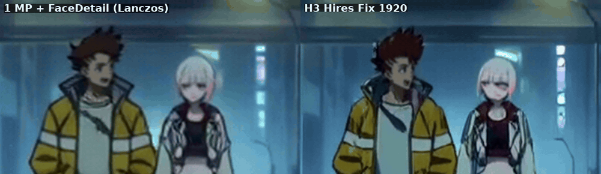

# ComfyUI-H3-ResCascade

**Render MiniMax H3 at 1 MP, finish at 1080p or 1440p: about half the time of a native render, with the same take and
the same audio.**

*Edgerunners LoRA, 1920x1088, after Fast De-rope + FaceDetail + Anime Cadence at 1 MP.*
([mp4 with sound](assets/demo_rocket_1920.mp4))

## What you get

- **About 2x faster than a native 1080p render.** 1920x1088 in 237 s instead of 492 s (RTX 5090, 5 s clip).
- **You keep the take you liked.** A native 1080p render is a different take from the 1 MP one (changing the
  resolution changes the whole render). Here the 1 MP render *is* the take: preview at 1 MP in ~2.5 min, then upscale
  only the keepers.
- **Your audio is untouched.** The pass-1 soundtrack is pinned; the hires output carries it sample for sample.
- **1440p on a 32 GB card.** 2560x1440 in ~337 s.
- **Real detail, not a blur.** The hires step redraws lines and texture at the new size: +29% fine-edge detail over a
  Lanczos upscale of the same take, with no frame-to-frame boil.
- **It keeps your fixes.** After Fast De-rope, FaceDetail and Anime Cadence, the impact frames, the redrawn faces and
  the 2s/3s holds all survive the upscale.

*De-roped impact frame (fist to camera), half speed. Left: the 1 MP result upscaled with Lanczos. Right: H3 Hires Fix
at 1920 (+66 s). Crisper eye, teeth and outlines.* ([mp4 with sound](assets/demo_detail_zoom.mp4))

*Small faces in a wide shot, ~4x zoom. Left: 1 MP + FaceDetail, Lanczos. Right: H3 Hires Fix at 1920 with
FaceDetail's face tiles re-stitched.* ([mp4 with sound](assets/demo_faces_zoom.mp4))

More finished 1920x1088 clips, with sound:
[classroom fight, Golden Boy LoRA](assets/final_1920_classroom_fight_5s.mp4) ·
[cyberpunk alley, 9 s, Edgerunners LoRA](assets/final_1920_cyberpunk_alley_9s.mp4) ·
[Re:Zero mecha, on 1s](assets/final_1920_rezero_mecha_smooth.mp4)

## Timings (RTX 5090, 124 frames unless noted)

| output | time |
|---|---|
| native 1920x1088, 20 steps | 492 s |
| **1 MP render + H3 Hires Fix (DMAD, 2 steps), 1920x1088** | **237 s** |
| 1 MP render + H3 Hires Fix (base model, 4 steps), 1920x1088 | ~280 s |
| 1 MP render + H3 Hires Fix, 2560x1440 | ~337 s |
| full anime pipeline at 1 MP (Fast De-rope, FaceDetail, Anime Cadence) + hires to 1920 | 309-451 s |
| same, 9 s clip / 15 s clip | 989 s / 1703 s |

Even with all the quality fixes, a 5 s clip finishes at 1920 faster than a bare native 1920 render without them.

## Why not "render low, upscale, refine"?

H3 decides layout, motion, acting **and the detail level** in the high-noise steps: with shift 12, 12 of the 20 steps
sit above sigma 0.8. A low-res first pass spends those steps on 4x fewer 32 px tokens. Tested here:

- A refine from ~0.9 (the usual recipe) re-decides the whole take.
- Dropping to half resolution only in the middle of the schedule is ~35% faster, but it loses about half the fine detail
  (iris colours, textures), and fast motion smears. Re-noising and 8 more full-res steps don't bring it back.
- Training-free attention shortcuts (pooled or windowed keys) break H3: half of a video token's attention goes to frames
  more than 2 latent frames away.

So: render at ~1 MP, where H3 is strong, and add only lines and texture at the bigger size.

## Nodes

- **H3 Hires Fix**: takes the pass-1 latent (or finished frames + a VAE), upscales it with LBH-123-AI's learned 3D latent
  upscaler (no VAE round trip), pins the pass-1 audio, re-noises to `sigma_start` (0.45) and runs the tail of the native
  schedule at the target size.
  - **Turbo is free here**, because the take is already fixed: feed a DMAD 0.8 model and set `steps_override` = 2.
    It looks the same as 4 base steps, 2.5x faster. (In pass 1 a turbo LoRA changes the take and the audio.)
  - For frames from Fast De-rope / FaceDetail, wire `images` and a VAE; taeh3 is fine for this encode.
- **H3 Hold Transfer**: gives the hires clip exactly the 2s/3s holds of the 1 MP clip, per pixel. Use it instead of
  re-running Anime Cadence after hires: re-running re-decides the cadence and can hold the wrong drawing over an impact
  frame.
- **H3 Face Atlas Rescale** / **H3 Face Atlas Stitch (chunked)**: re-stitch FaceDetail's 512 px face tiles onto the
  hires frames. A hires refine redraws small faces from ~2 tokens again, and a latent upscale turns them to smudges. The
  chunked stitch keeps RAM in check on long clips (15 s at 1920).
- **H3 Front-Loaded Sigmas**: a pass-1 speed-up without a LoRA. It keeps every native step down to sigma 0.79 and takes
  the rest in 4 bigger base-model steps (H3's output heads are step-size aware): -24% sampling, same take frame for frame
  (audio correlation 0.98). Spreading the same number of steps evenly changes the acting.
- **H3 Resolution Switch** (research): change the resolution mid-schedule while staying on the same trajectory. It
  works, but on H3 it costs detail (see above).

## Example workflows

- `example_workflows/h3_hires_1080p.json`: t2v at 1 MP -> H3 Hires Fix (DMAD) -> 1920x1088.
- `example_workflows/h3_fast_derope_face_hires.json`: t2v 1 MP -> Fast De-rope -> FaceDetail -> Anime Cadence -> H3 Hires
  Fix (taeh3 encode, DMAD) -> FaceDetail tiles re-stitched at 1920 -> Hold Transfer.

## Requirements

- [LBH-123-AI's latent upscaler](https://github.com/LBH-123-AI/Comfyui_Minimax_h3_latent_Upscaler) installed, with its
  weights from [Hugging Face](https://huggingface.co/LBH-123-AI/Minimax_h3_latent_Upscaler) in
  `models/latent_upscale_models` (H3 Hires Fix uses its model loader).
- A DMAD turbo LoRA for H3 for the fast refine (optional: without it, use the pass-1 model and `steps_override` 0).
- For the full anime workflow: [ComfyUI-H3-FastDerope](https://github.com/tazmannner/ComfyUI-H3-FastDerope),
  [ComfyUI-H3-FaceDetail](https://github.com/tazmannner/ComfyUI-H3-FaceDetail) and ComfyUI-H3-AnimeCadence.

## Limitations

- The refine at sigma 0.45 redraws a little: small full-body figures can come out a few pixels larger or shifted, and
  the fastest trailing parts (a hair streak in a punch) pick up some motion blur.
- Long clips need system RAM: at 15 s and 1920, use the chunked face stitch (the example workflow does).
- Tested on an RTX 5090 (32 GB) with anime LoRAs (Edgerunners, Teen Titans, Re:Zero, Golden Boy), base H3 and live
  action.

## Credits

The learned latent upscale is LBH-123-AI's
[Minimax H3 Latent Upscaler](https://huggingface.co/LBH-123-AI/Minimax_h3_latent_Upscaler); this pack calls it.
